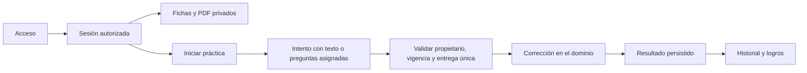

# Organización del proyecto

La presentación y las vistas del campus están en `frontend/`. Las reglas de acceso,
las prácticas, el almacenamiento y el transporte HTTP están en `backend/`.
Los documentos de estudio y los datos de estudiantes permanecen fuera de ambos.
Se conserva Python y JavaScript nativo: no hay una migración de framework.

```
frontend/
  public/       presentación que puede publicarse en Pages
  campus/       vistas y módulos JS del campus; el servidor exige sesión
  access.html   pantalla de ingreso
backend/
  domain.py     modos de práctica y funciones puras de corrección
  access.py     códigos, sesiones y revocación
  practices.py  inicio, entrega y resultados; transacciones por intento
  storage.py    SQLite y evolución compatible del esquema existente
  library.py    lectura desde almacenamiento privado
  app.py        transporte HTTP y rutas; no decide puntuaciones
  cli.py        arranque y comandos administrativos
scripts/        generación, publicación y entregas
tests/          reglas de dominio, seguridad, arquitectura y publicación
docs/           decisiones, uso y límites
```

En el frontend del campus, `api.js` administra solicitudes y CSRF, `navigation.js`
las secciones, `exams.js` los exámenes, `typing.js` la transcripción, `results.js`
resultados y logros, y `library.js` los materiales. `app.js` solo inicia la pantalla.
No se exponen funciones globales para conectar estos módulos.

## Modelo del dominio

El modelo se infiere de las funciones ya solicitadas; no incluye cobros ni matrícula
automática que aún no existen. Los nombres de las tablas heredadas se conservan
para no romper avances: `username` representa la etiqueta interna de un acceso,
no un usuario solicitado en el formulario.

| Concepto | Identidad y reglas |
| --- | --- |
| Acceso | Etiqueta interna y huella de código. Puede estar activo, vencido o revocado. |
| Sesión | Token opaco asociado a un acceso; vence y se comprueba en cada recurso privado. |
| Módulo | Uno de cinco temas. Vincula documentos y prácticas, no contiene identidad del estudiante. |
| Modo de práctica | Valor inmutable: módulo 1–5, integrador, lectura o mecanografía. Solo el primero admite número de módulo. |
| Intento | Identidad propia, acceso propietario, modo, preguntas o texto asignado e inicio. Solo puede corregirse una vez. |
| Resultado | Hecho de una entrega corregida; puntaje, total, fecha y devolución. |
| Recorrido de textos | Estado por acceso y herramienta; sorteo sin reemplazo y sin repetición inmediata. |
| Ficha de biblioteca | Recurso editorial independiente: resumen, mapa, comparación, esquema y referencias. |



La frontera de consistencia de la práctica es el intento. Selección de texto,
rotación e inicio se realizan en una transacción; corrección y resultado en otra.
Las funciones de corrección no conocen HTTP ni SQLite. No se agregan buses de
eventos, servicios distribuidos ni repositorios abstractos sin una necesidad real.

## Entregas separadas

- `scripts/package_pages.py`: solo `frontend/public` permitido; excluye campus y backend.
- `scripts/package_repository.py`: código fuente, pruebas y documentación, sin datos privados.
- `scripts/package_friend.py`: ZIP privado para una prueba local, con base nueva y código propio.

La separación de carpetas no reemplaza la autorización del servidor. GitHub Pages
continúa publicando solo la presentación. El servidor actual escucha exclusivamente
en loopback y sigue siendo una prueba local, sin aptitud de producción.
